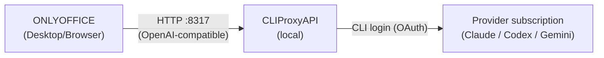

import Tabs from '@theme/Tabs';
import TabItem from '@theme/TabItem';

# Using CLIProxyAPI with a CLI subscription

[CLIProxyAPI](https://github.com/router-for-me/CLIProxyAPI) wraps a command-line AI subscription — such as Claude Code, Codex, Gemini CLI, or Qwen Code — and exposes it as an **OpenAI-compatible** HTTP endpoint. Because the AI plugin can connect to any OpenAI-compatible endpoint, you can point it at a local CLIProxyAPI instance so the plugin runs on your existing subscription login instead of a separately billed provider API key.

This guide uses a Claude subscription as the example; the same steps apply to the other CLIs that CLIProxyAPI supports.

:::note
CLIProxyAPI signs in through your provider's own CLI login (OAuth). Review your AI provider's terms before using a subscription login with third-party software, keep the proxy bound to the local machine, and note that your subscription's usage limits continue to apply.
:::

## How it works



The AI plugin sends OpenAI-style requests to CLIProxyAPI, which forwards them to the provider using your CLI subscription credentials and streams the response back.

## Prerequisites

- A logged-in subscription for a CLI that CLIProxyAPI supports (for example, a Claude Pro or Max plan).
- ONLYOFFICE Docs **8.2** or later with the AI plugin enabled. See [The AI plugin](ai-plugin.md).

## Step 1. Install CLIProxyAPI {#install}

<Tabs>
  <TabItem value="macos" label="macOS (Homebrew)">

```bash
brew install cliproxyapi
```

  </TabItem>
  <TabItem value="binary" label="Binary">

Download the archive for your platform from the [releases page](https://github.com/router-for-me/CLIProxyAPI/releases) and extract the `cli-proxy-api` binary.

  </TabItem>
  <TabItem value="docker" label="Docker">

```bash
docker run --rm -p 8317:8317 \
  -v "$HOME/.cli-proxy-api:/root/.cli-proxy-api" \
  eceasy/cli-proxy-api:latest
```

  </TabItem>
</Tabs>

## Step 2. Authenticate your subscription {#authenticate}

Run the login flow for your provider. It opens a browser; sign in and approve.

```bash
cliproxyapi -claude-login
```

The credential is stored in the OAuth directory (`~/.cli-proxy-api/` by default). Add `-no-browser` to print the sign-in URL instead of opening a browser, which is useful over SSH. For the full list of providers and their login flags, run `cliproxyapi --help`.

## Step 3. Configure host, port, and access key {#configure}

Edit the configuration file — `/opt/homebrew/etc/cliproxyapi.conf` for a Homebrew install, otherwise `~/.cli-proxy-api/config.yaml`:

```yaml
server:
  host: "127.0.0.1"          # local machine only; use "" to expose on the network
  port: 8317

access:
  api-keys:
    - "onlyoffice-local"     # the key ONLYOFFICE sends to the proxy; choose any value
```

The `access.api-keys` value is a gate for *clients of the proxy*. It is not your subscription credential and does not leave the machine.

## Step 4. Start and verify the endpoint {#verify}

```bash
brew services start cliproxyapi          # start now and on login (Homebrew)
# or run it directly:  cliproxyapi
```

Confirm the endpoint responds with a list of models:

```bash
curl -s http://127.0.0.1:8317/v1/models \
  -H "Authorization: Bearer onlyoffice-local"
```

A quick completion check:

```bash
curl -s http://127.0.0.1:8317/v1/chat/completions \
  -H "Authorization: Bearer onlyoffice-local" \
  -H "Content-Type: application/json" \
  -d '{"model":"claude-haiku-4-5","max_tokens":20,
       "messages":[{"role":"user","content":"Reply with: OK"}]}'
```

:::note
Requests from the AI plugin are cross-origin. CLIProxyAPI returns `Access-Control-Allow-Origin: *` and answers preflight `OPTIONS` requests, so the plugin's `onlyoffice://plugin` origin — and a browser-based Document Server — can reach it with no additional configuration. This differs from some local servers that require an explicit allowlist; compare [Configuring Ollama with CORS](configuring-ollama-with-cors.md). For the general rule, see the CORS note in [Adding custom providers](custom-providers.md).
:::

## Step 5. Add the provider in ONLYOFFICE {#add-provider}

Open the **AI Tools** tab → **Settings** → **AI Models** → **Add Model**, and fill in:

| Field        | Value                                                                 |
|--------------|-----------------------------------------------------------------------|
| Provider     | **OpenAI**                                                            |
| API key      | `onlyoffice-local`                                                    |
| Base URL     | `http://127.0.0.1:8317/v1`                                            |
| Model        | select one — the list is fetched live from the proxy (for example, `claude-sonnet-4-5`) |
| Profile name | any label, for example `Claude (local)`                              |

Click **Add Model**. Then open **Model Assignment** and set the **Default model** to the entry you added, so every task — AI Chat, Summarization, Translation, and so on — uses it.

:::note
On macOS, the **API key** field is a password field, so the system may hold it in secure-input mode. Click the show (eye) icon to turn it into a plain text field before pasting the key.
:::

Alternatively, you can import a one-file custom provider that has the base URL and key baked in, so you only choose a model. See [Adding custom providers](custom-providers.md) and set the base URL to `http://127.0.0.1:8317` with the addon `v1`.

## Verify inside the editor

Open **AI Chat** and send a short prompt, or select a paragraph and run **Summarize** or **Rewrite**. A response confirms the full path — ONLYOFFICE → CLIProxyAPI → your subscription — is working.

## Troubleshooting

### "Connection error" in the Add Model form

Confirm the proxy is running (`curl http://127.0.0.1:8317/v1/models`) and that the **Base URL** ends in `/v1`.

### The model list stays empty

The API key is missing or does not match an entry in `access.api-keys`. Re-check **Step 3**.

### The proxy returns `401 Unauthorized`

The `Authorization` header sent by the plugin does not match a key in `access.api-keys`.

### It works in `curl` but not in the editor

Re-open **AI Tools → Settings** and make sure the new model is the **Default model** (or is assigned to the task you are using) in **Model Assignment**.

### Replies stop working after a while

The subscription login expired. Re-run the login flow from **Step 2**.

## Network access (optional)

To reach the proxy from other machines, set `server.host: ""` to bind all interfaces, and place it behind a reverse proxy that terminates TLS and forwards CORS headers. The reverse-proxy pattern shown in [Configuring Ollama with CORS](configuring-ollama-with-cors.md#basic-nginx-configuration) applies here as well.

:::warning
Exposing the endpoint to a network makes your subscription reachable by anything that can connect to it. Bind it to `127.0.0.1` unless you have added authentication and TLS, and keep subscription-backed access on trusted machines only.
:::
